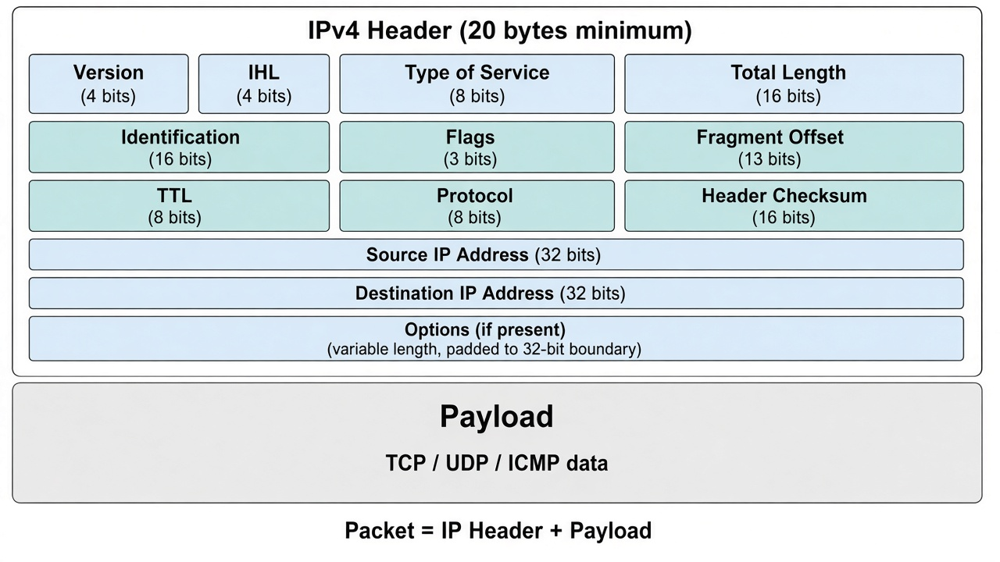

# IPv4 Packet Header — Simple Notes

Plain-English study notes for **Jeremy's IT Lab** Day 10 (IPv4 header). Same fields as the video, written so they're easier to remember.

**Author:** Innocent Nkosiyethu Mbatha (CCNA candidate)

---

## What is an IPv4 packet?

At Layer 3, data travels as a **packet**.

- The **header** is the "address label" routers read to forward the packet.
- The **payload** is the real data (usually a TCP/UDP segment, or ICMP).

You do not need to memorize every bit on day one. Learn what each field *does*.

---

## Quick reminder: PDUs

As data goes down the OSI stack, each layer wraps it:

| Name | What it is |
|------|------------|
| **Data** | What the app sent |
| **Segment** | Data + Layer 4 header |
| **Packet** | Segment + Layer 3 (IP) header |
| **Frame** | Packet + Layer 2 header + Layer 2 trailer |

**Packet** = the Layer 3 PDU. That is what this page is about.

---

## Version (4 bits)

Tells devices which IP version this is.

- IPv4 → value **4**
- IPv6 → value **6**

---

## IHL — Internet Header Length (4 bits)

How long the IP header is.

- Measured in **4-byte chunks** (not single bytes).
- Value **5** → 5 × 4 = **20 bytes** (normal header, no options)
- Value **15** → 15 × 4 = **60 bytes** (maximum)

**Remember:** min header = **20 bytes**, max = **60 bytes**.  
If IHL is greater than 5, **Options** are present.

---

## DSCP (6 bits)

A Quality of Service (QoS) hint.

Routers/switches that support QoS can use this to treat some traffic (like voice or video) as higher priority.

---

## ECN (2 bits)

Optional way to say "the path is congested" **without dropping the packet**.

Needs support on both ends and along the path. If anything in the path does not support it, it may not help.

---

## Total Length (16 bits)

Size of the **whole packet** in **bytes** (header + payload).

- Not measured in 4-byte chunks (unlike IHL).
- Practical minimum is often **20** (header only, no data).
- Maximum is **65,535** (biggest 16-bit number).

---

## Identification (16 bits)

Used when a packet is **fragmented** (split into pieces).

All fragments from the same original packet share the **same Identification** value so the receiver can match them.

---

## Flags (3 bits)

Controls fragmentation:

| Bit | Name | Meaning |
|-----|------|---------|
| 0 | Reserved | Always 0 |
| 1 | **DF** (Don't Fragment) | 1 = do **not** fragment this packet |
| 2 | **MF** (More Fragments) | 1 = more pieces coming; 0 = this is the last piece (or not fragmented) |

Unfragmented packets have MF = 0.

---

## Fragment Offset (13 bits)

Where this fragment sits inside the original packet.

That way the receiving host can rebuild the packet even if pieces arrive **out of order**.

**Important:** routers may fragment; the **receiving host** reassembles.

Packets get fragmented when they are bigger than the path **MTU** (Maximum Transmission Unit). On Ethernet the MTU is usually **1500 bytes**.

---

## TTL — Time to Live (8 bits)

A **hop counter** that stops packets looping forever.

- Each router that forwards the packet subtracts **1**.
- When TTL hits **0**, the router **drops** the packet.

Old design idea was "seconds of life." In practice today it means hops.

---

## Protocol (8 bits)

Says what is **inside** the packet (the next header / payload type):

| Value | Protocol |
|------:|----------|
| 1 | ICMP |
| 6 | TCP |
| 17 | UDP |
| 89 | OSPF |

Example: Protocol `1` means this packet carries ICMP (like ping).

---

## Header Checksum (16 bits)

Error check for the **IPv4 header only**.

A router recalculates the checksum. If it does not match the field → **drop the packet**.

It does **not** protect the payload. TCP/UDP (and similar) have their own checksums for the data inside.

---

## Source IP / Destination IP (32 bits each)

- **Source:** who sent the packet.
- **Destination:** who should receive it.

These are normal IPv4 addresses (e.g. `192.168.1.10`).

---

## Options (0–320 bits) — rare

Extra optional fields at the end of the header.

- Rarely used on the real Internet.
- Present when **IHL > 5**.

---

## One-line cheat sheet

| Field | Bits | In one line |
|-------|-----:|-------------|
| Version | 4 | IPv4 or IPv6? |
| IHL | 4 | How long is the header? (×4 bytes) |
| DSCP | 6 | QoS priority hint |
| ECN | 2 | Congestion signal (optional) |
| Total Length | 16 | Whole packet size in bytes |
| Identification | 16 | ID shared by all fragments |
| Flags | 3 | DF / MF fragmentation control |
| Fragment Offset | 13 | Where this piece belongs |
| TTL | 8 | Hop limit; 0 = drop |
| Protocol | 8 | What's inside (TCP/UDP/ICMP/…) |
| Header Checksum | 16 | Header error check only |
| Source IP | 32 | Sender |
| Destination IP | 32 | Receiver |
| Options | 0–320 | Rare extras (IHL > 5) |

---

## Study tip

Jeremy covers a lot of detail on purpose for the exam. You are not "behind" if you need a simpler pass first.

1. Learn the **cheat sheet** above.
2. Rewatch Day 10 and match each field to one line.
3. In Packet Tracer / Wireshark, open a real packet and find Version, TTL, Protocol, and the two IPs.

---

*Simplified rewrite of Day 10 notebook notes for faster revision.*
